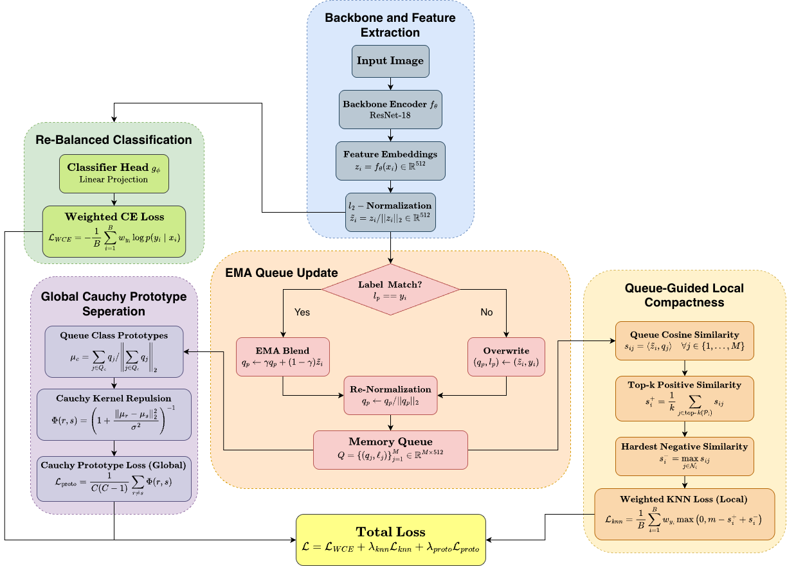
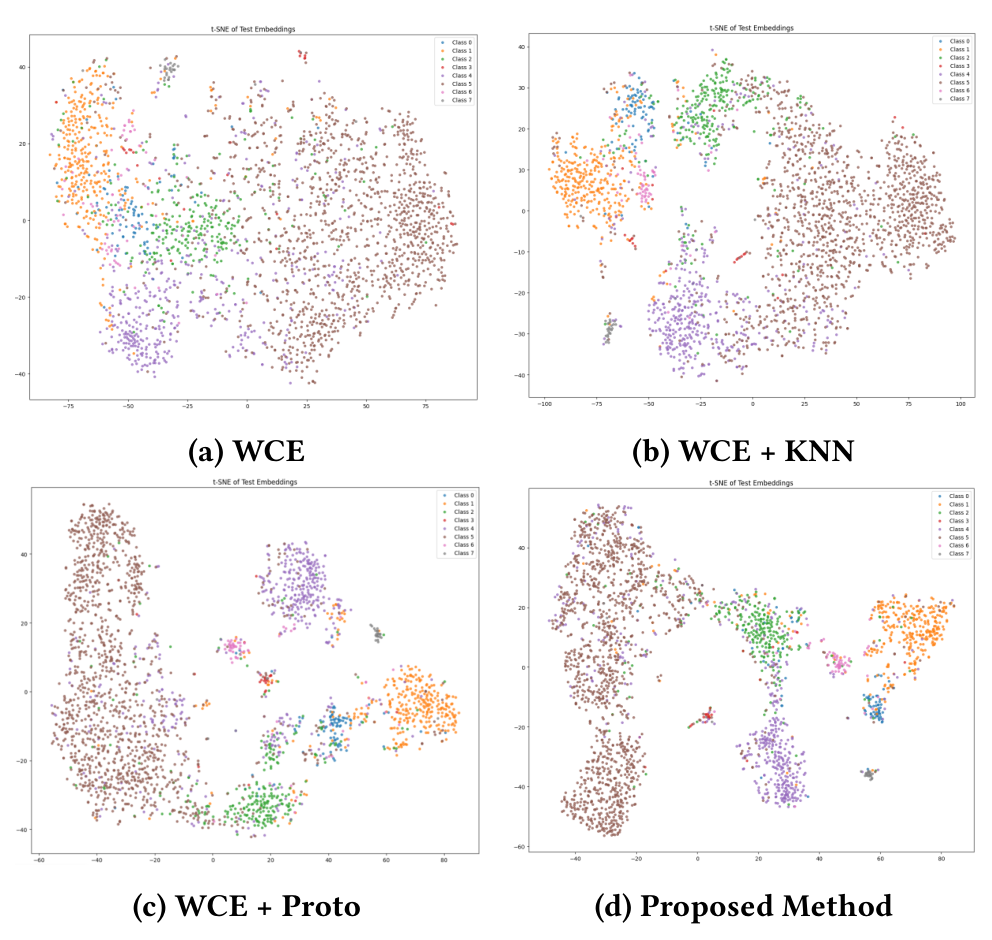
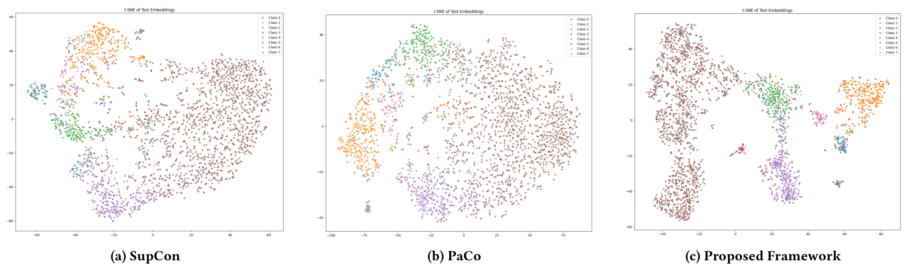

# Local Compactness and Global Repulsion: A Memory-Queue Framework for Imbalanced Skin Lesion Classification

<p align="center">
  <a href="https://pytorch.org/"></a>
  <a href="https://www.python.org/"></a>
  <a href="https://icvgip2026.org/"></a>
  <a href="https://dl.acm.org/"></a>
  <a href="https://opensource.org/licenses/MIT"></a>
</p>

Official repository for the paper **"Local Compactness and Global Repulsion: A Memory-Queue Framework for Imbalanced Skin Lesion Classification"**, accepted in the *Proceedings of the 17th Indian Conference on Computer Vision, Graphics and Image Processing (ICVGIP 2026)*, ACM.

---

## Table of Contents
- [Overview and Motivation](#overview-and-motivation)
- [Methodology](#methodology)
  - [Workflow Overview](#workflow-overview)
  - [Mathematical Formulation](#mathematical-formulation)
  - [Gradient Flow and Differentiability](#gradient-flow-and-differentiability)
- [Representation Analysis (t-SNE)](#representation-analysis-t-sne)
  - [Component-wise Latent Space Restructuring](#component-wise-latent-space-restructuring)
  - [Comparison with Metric Learning Baselines](#comparison-with-metric-learning-baselines)
- [Experimental Results](#experimental-results)
  - [Benchmark Comparison with Loss Functions](#1-benchmark-comparison-with-loss-functions)
  - [Per-Class Recall and Diagnostic Balance (ISIC 2019)](#2-per-class-recall-and-diagnostic-balance-isic-2019)
  - [Embedding Quality and Geometric Separation Metrics](#3-embedding-quality-and-geometric-separation-metrics)
  - [Component Ablation Study](#4-component-ablation-study)
  - [Prototype Separation Kernel Analysis](#5-prototype-separation-kernel-analysis)
  - [Queue Design and Dynamics Analysis](#6-queue-design-and-dynamics-analysis)
- [Repository Structure](#repository-structure)
- [Environment Setup](#environment-setup)
- [Dataset Preparation](#dataset-preparation)
- [Citation](#citation)
- [License and Acknowledgments](#license-and-acknowledgments)

---

## Overview and Motivation

Automated dermoscopic image classification plays an important role in early skin cancer screening. However, real-world dermatological datasets are inherently long-tailed. Common benign conditions such as melanocytic nevi (`NV`) represent the overwhelming majority of cases, while high-risk or rare malignancies such as dermatofibroma (`DF`), vascular lesions (`VASC`), squamous cell carcinoma (`SCC`), and actinic keratosis (`AK`) appear infrequently.

When trained under standard loss formulations, neural networks often achieve high nominal accuracy by defaulting toward the majority class, sacrificing sensitivity on critical minority conditions. Existing strategies typically run into two primary limitations:

1. **Logit-Level Reweighting (Focal Loss, LDAM, Balanced Softmax):** These methods re-scale class penalties at the classifier head, but leave the underlying feature representations largely unconstrained. As a result, minority samples remain dispersed in latent space and heavily entangled with dominant classes.
2. **Batch-Level Contrastive and Metric Learning (SupCon, PaCo):** These frameworks rely on mini-batch sampling to mine positive and negative pairs. Under heavy imbalance, rare classes appear with zero or few instances per batch, resulting in high gradient variance and unreliable prototype updates.

### Proposed Approach

We address these challenges through a dual-scale metric learning framework paired with an Exponential Moving Average (EMA) memory queue ($M = 4096$):

- **Decoupled Feature Bank:** The persistent memory queue decouples representation statistics from mini-batch size, providing consistent positive and negative sample pools for minority classes throughout training.
- **Local Regularization ($\mathcal{L}_{\text{knn}}$):** Enforces local intra-class compactness by contrasting top-$k$ nearest neighbors against the hardest inter-class negative in the queue.
- **Global Regularization ($\mathcal{L}_{\text{proto}}$):** Repels class prototypes globally across the hypersphere using a heavy-tailed Cauchy kernel, preventing early gradient plateauing and cluster collapse.
- **Balanced Multi-Task Learning:** Integrates effective-number weighted cross-entropy ($\mathcal{L}_{\text{WCE}}$) with smooth loss weight scheduling to stabilize early representation learning.

---

## Methodology

### Workflow Overview

<p align="center">
  
  <br>
  <em>Figure 1: Workflow of the proposed memory-queue guided metric learning framework.</em>
</p>

### Mathematical Formulation

The overall objective optimizes a multi-task loss balanced by epoch-dependent scheduling weights $\lambda_{\text{knn}}(t)$ and $\lambda_{\text{proto}}(t)$:

$$\mathcal{L} = \mathcal{L}_{\text{WCE}} + \lambda_{\text{knn}}(t)\,\mathcal{L}_{\text{knn}} + \lambda_{\text{proto}}(t)\,\mathcal{L}_{\text{proto}}$$

#### 1. Feature Extraction and Hypersphere Projection
Given an input sample $x_i$, a ResNet-18 backbone extracts an embedding vector $z_i = f_\theta(x_i) \in \mathbb{R}^{512}$, which is $\ell_2$-normalized onto the unit hypersphere:

$$\tilde{z}_i = \frac{z_i}{\|z_i\|_2 + \epsilon}$$

#### 2. Class-Rebalanced Classification Loss ($\mathcal{L}_{\text{WCE}}$)
To account for class frequency disparity, we compute effective-number sample weights controlled by redundancy parameter $\beta = 0.999$:

$$w_c = \frac{1 - \beta}{1 - \beta^{n_c}}$$

$$\mathcal{L}_{\text{WCE}} = -\frac{1}{B}\sum_{i=1}^B w_{y_i}\log p(y_i \mid x_i)$$

#### 3. Dynamic EMA Memory Queue ($\mathcal{Q}$)
We maintain a persistent feature queue $\mathcal{Q} = \{(q_j, \ell_j)\}_{j=1}^M$ of capacity $M = 4096$. For queue entries matching the active sample class, updates are applied via exponential moving average ($\gamma = 0.99$):

$$q_p \leftarrow \begin{cases} \gamma q_p + (1-\gamma)\tilde{z}_i, & \text{if } \ell_p = y_i \\ \tilde{z}_i, & \text{otherwise} \end{cases}, \qquad q_p \leftarrow \frac{q_p}{\|q_p\|_2}$$

#### 4. Weighted $k$-Nearest Neighbours Loss ($\mathcal{L}_{\text{knn}}$)
The local loss pulls an anchor $\tilde{z}_i$ closer to its top-$k$ same-class neighbors in $\mathcal{Q}$ while pushing it away from the single most confusable negative:

$$s_i^+ = \frac{1}{k}\sum_{j \in \text{top-}k(\mathcal{P}_i)} \langle\tilde{z}_i, q_j\rangle, \qquad s_i^- = \max_{j \in \mathcal{N}_i} \langle\tilde{z}_i, q_j\rangle$$

$$\mathcal{L}_{\text{knn}} = \frac{1}{B}\sum_{i=1}^B w_{y_i}\max\left(0,\, m - s_i^+ + s_i^-\right)$$

where $k = 10$, margin $m = 0.2$, and $w_{y_i}$ applies class-balanced weighting.

#### 5. Cauchy Prototype Separation Loss ($\mathcal{L}_{\text{proto}}$)
Prototypes are calculated as joint centroids combining current batch instances and detached queue entries:

$$v_c = \sum_{i \in \mathcal{B}_c} \tilde{z}_i + \sum_{j \in \mathcal{Q}_c} \operatorname{sg}(q_j), \qquad \mu_c = \frac{v_c}{\|v_c\|_2 + \epsilon}$$

Pairwise prototype similarity is evaluated using a heavy-tailed Cauchy kernel with bandwidth $\sigma = 0.5$:

$$\Phi(r, s) = \frac{1}{1 + \|\mu_r - \mu_s\|_2^2 / \sigma^2}$$

$$\mathcal{L}_{\text{proto}} = \frac{1}{C(C-1)}\sum_{r \neq s} \Phi(r, s)$$

#### 6. Loss Weight Scheduling
To prevent premature regularisation before the memory queue populates adequately, loss weights follow a warm-up schedule ($\tau = 15, T = 60, \lambda_{\max} = 0.5$):

$$\lambda(t) = \lambda_{\max} \cdot \frac{1 - e^{-t/\tau}}{1 - e^{-T/\tau}}$$

---

### Gradient Flow and Differentiability

Although queue embeddings $\mathcal{Q}_c$ are treated as detached historical records ($\operatorname{sg}(q_j)$) updated after parameter optimization, active mini-batch embeddings $\tilde{z}_i(\theta) \in \mathcal{B}_c$ maintain complete autograd connections to the encoder.

Differentiating the prototype separation loss with respect to a batch embedding $\tilde{z}_i$ yields:

$$\frac{\partial \mathcal{L}_{\text{proto}}}{\partial \tilde{z}_i} \propto \frac{(\mathbf{I} - \mu_r \mu_r^\top)(\mu_r - \mu_s)}{\|v_r\|_2} \neq \mathbf{0}$$

This formulation guarantees consistent, non-zero gradient backpropagation throughout training, avoiding gradient detachment while leveraging queue stability.

---

## Representation Analysis (t-SNE)

### Component-wise Latent Space Restructuring

<p align="center">
  
  <br>
  <em>Figure 2: t-SNE visualisations of test embeddings on ISIC 2019 across individual components: (a) WCE, (b) WCE + KNN, (c) WCE + Proto, and (d) Proposed Framework.</em>
</p>

- **(a) Weighted Cross-Entropy (WCE):** Significant class overlap; rare pathologies are dispersed and entangled within the central `NV` cluster.
- **(b) WCE + KNN:** Enforces local neighborhood cohesion, pulling same-class samples into tighter sub-clusters and clarifying local decision boundaries.
- **(c) WCE + Proto:** Repels class centers globally, driving individual class groupings outward across the latent space.
- **(d) Full Proposed Framework:** The combination of local cohesion and global repulsion results in well-isolated, compact clusters across all eight categories.

---

### Comparison with Metric Learning Baselines

<p align="center">
  
  <br>
  <em>Figure 3: Comparison of test set latent representations on ISIC 2019: (a) Supervised Contrastive (SupCon), (b) Parametric Contrastive (PaCo), and (c) Proposed Framework.</em>
</p>

- **SupCon:** Produces dense clusters for dominant classes but forces minority categories toward the cluster margins where misclassifications persist.
- **PaCo:** Adds parametric class centers, improving stability but leaving noticeable boundary confusion among visually similar categories.
- **Proposed Framework:** Distributes representations evenly over the hypersphere, maintaining clear separation margins for rare classes without degrading majority class structure.

---

## Experimental Results

All experiments were conducted on an NVIDIA Tesla T4 GPU and evaluated across five independent runs using stratified 80/10/10 splits.

### 1. Benchmark Comparison with Loss Functions

| Loss Function | Venue / Source | ISIC 2018 Overall Acc (%) | ISIC 2018 Bal Acc (%) | ISIC 2018 Macro F1 (%) | ISIC 2019 Overall Acc (%) | ISIC 2019 Bal Acc (%) | ISIC 2019 Macro F1 (%) |
|:---|:---:|:---:|:---:|:---:|:---:|:---:|:---:|
| Weighted CE | CVPR 2019 | $81.22 \pm 1.56$ | $75.44 \pm 1.72$ | $73.91 \pm 1.81$ | $77.10 \pm 1.61$ | $66.74 \pm 1.56$ | $65.61 \pm 1.63$ |
| Focal Loss | ICCV 2017 | $82.72 \pm 1.67$ | $76.84 \pm 1.73$ | $76.05 \pm 1.90$ | $76.27 \pm 1.51$ | $65.91 \pm 1.67$ | $66.19 \pm 1.64$ |
| LDAM | NeurIPS 2019 | $81.42 \pm 1.42$ | $75.42 \pm 1.65$ | $74.10 \pm 1.68$ | $77.77 \pm 1.72$ | $67.76 \pm 1.79$ | $64.67 \pm 1.78$ |
| Balanced Softmax | NeurIPS 2020 | $83.72 \pm 1.78$ | $77.54 \pm 1.79$ | $72.55 \pm 1.78$ | $77.30 \pm 1.49$ | $64.36 \pm 1.52$ | $64.29 \pm 1.61$ |
| SupCon | NeurIPS 2020 | $86.21 \pm 2.01$ | $78.09 \pm 1.96$ | **$78.09 \pm 1.98$** | $81.46 \pm 1.68$ | $70.73 \pm 1.91$ | $71.27 \pm 1.92$ |
| PaCo | ICCV 2021 | $86.31 \pm 1.79$ | $78.43 \pm 1.83$ | $77.01 \pm 1.80$ | $81.58 \pm 1.89$ | $71.19 \pm 2.04$ | $70.01 \pm 1.95$ |
| **Proposed Method** | **ICVGIP 2026** | **$87.41 \pm 2.03$** | **$79.32 \pm 1.87$** | $77.89 \pm 1.91$ | **$82.78 \pm 1.97$** | **$71.97 \pm 1.93$** | **$72.40 \pm 1.91$** |

---

### 2. Per-Class Recall and Diagnostic Balance (ISIC 2019)

| Class | Description | SupCon | PaCo | Proposed Method | Difference vs Best Baseline |
|:---|:---|:---:|:---:|:---:|:---:|
| **NV** | Melanocytic Nevus (Majority ~51%) | $91.00 \pm 0.28$ | $90.35 \pm 0.31$ | **$92.20 \pm 0.25$** | +1.20% |
| **MEL** | Melanoma | $77.02 \pm 1.22$ | **$79.01 \pm 1.34$** | $77.61 \pm 1.15$ | -1.40% |
| **BCC** | Basal Cell Carcinoma | $74.12 \pm 1.45$ | $74.67 \pm 1.51$ | **$76.60 \pm 1.39$** | +1.93% |
| **BKL** | Benign Keratosis | $65.40 \pm 1.61$ | $65.97 \pm 1.47$ | **$67.80 \pm 1.52$** | +1.83% |
| **AK** | Actinic Keratosis | **$52.32 \pm 3.15$** | $51.48 \pm 3.01$ | $52.05 \pm 2.85$ | -0.27% |
| **SCC** | Squamous Cell Carcinoma | $78.25 \pm 3.52$ | $76.41 \pm 3.69$ | **$78.95 \pm 3.27$** | +0.70% |
| **VASC** | Vascular Lesion (Rare ~1.0%) | $57.63 \pm 5.18$ | $58.81 \pm 4.54$ | **$59.79 \pm 4.89$** | +0.98% |
| **DF** | Dermatofibroma (Rare ~0.9%) | $70.10 \pm 5.69$ | **$72.82 \pm 6.17$** | $70.76 \pm 5.42$ | -2.06% |
| **Balanced Accuracy** | Overall across classes | $70.73 \pm 1.91$ | $71.19 \pm 2.04$ | **$71.97 \pm 1.93$** | +0.78% |
| **Overall Accuracy** | Standard accuracy | $81.46 \pm 1.68$ | $81.58 \pm 1.89$ | **$82.78 \pm 1.97$** | +1.20% |

---

### 3. Embedding Quality and Geometric Separation Metrics

The following metrics quantitatively assess geometric cluster quality on the hypersphere:

| Benchmark | Metric | SupCon | PaCo | Proposed Method |
|:---|:---|:---:|:---:|:---:|
| **ISIC 2018** | Silhouette Index ($\uparrow$) | **$0.1823 \pm 0.0211$** | $0.1367 \pm 0.0230$ | $0.1819 \pm 0.0130$ |
| | KNN Purity ($\uparrow$) | $0.7927 \pm 0.0397$ | $0.8075 \pm 0.0370$ | **$0.8187 \pm 0.0381$** |
| | Intra-Class Cosine ($\uparrow$) | **$0.8656 \pm 0.0438$** | $0.7931 \pm 0.0478$ | $0.7660 \pm 0.0315$ |
| | Inter-Class Cosine ($\downarrow$) | $0.6850 \pm 0.0431$ | $0.5862 \pm 0.0390$ | **$0.5305 \pm 0.0361$** |
| | Margin ($\uparrow$) | $0.1806 \pm 0.0192$ | $0.2069 \pm 0.0199$ | **$0.2355 \pm 0.0231$** |
| | Separation Ratio ($\uparrow$) | $1.26 \pm 0.14$ | $1.35 \pm 0.15$ | **$1.44 \pm 0.14$** |
| **ISIC 2019** | Silhouette Index ($\uparrow$) | **$0.2484 \pm 0.0196$** | $0.2229 \pm 0.0183$ | $0.2363 \pm 0.0170$ |
| | KNN Purity ($\uparrow$) | $0.7209 \pm 0.0398$ | $0.7465 \pm 0.0361$ | **$0.7684 \pm 0.0327$** |
| | Intra-Class Cosine ($\uparrow$) | **$0.9099 \pm 0.0512$** | $0.8583 \pm 0.0400$ | $0.7878 \pm 0.0387$ |
| | Inter-Class Cosine ($\downarrow$) | $0.7816 \pm 0.0298$ | $0.6760 \pm 0.0412$ | **$0.5201 \pm 0.0304$** |
| | Margin ($\uparrow$) | $0.1283 \pm 0.0189$ | $0.1823 \pm 0.0196$ | **$0.2677 \pm 0.0201$** |
| | Separation Ratio ($\uparrow$) | $1.16 \pm 0.13$ | $1.27 \pm 0.15$ | **$1.51 \pm 0.17$** |

*Note: Higher Intra-Class Cosine under SupCon reflects inward compression of dominant classes rather than true inter-class discriminability. In contrast, our framework achieves the lowest Inter-Class Cosine and widest margins, directly correlating with balanced classification gains.*

---

### 4. Component Ablation Study

| Method Configuration | ISIC 2018 Overall Acc (%) | ISIC 2018 Bal Acc (%) | ISIC 2018 Macro F1 (%) | ISIC 2019 Overall Acc (%) | ISIC 2019 Bal Acc (%) | ISIC 2019 Macro F1 (%) |
|:---|:---:|:---:|:---:|:---:|:---:|:---:|
| $\mathcal{L}_{\text{WCE}}$ | $81.22 \pm 1.56$ | $75.44 \pm 1.72$ | $73.91 \pm 1.81$ | $77.10 \pm 1.61$ | $66.74 \pm 1.56$ | $65.61 \pm 1.63$ |
| $\mathcal{L}_{\text{WCE}} + \mathcal{L}_{\text{knn}}$ | $84.50 \pm 1.77$ | $77.39 \pm 1.89$ | $76.32 \pm 1.91$ | $79.87 \pm 1.79$ | $70.35 \pm 1.81$ | $69.73 \pm 1.83$ |
| $\mathcal{L}_{\text{WCE}} + \mathcal{L}_{\text{proto}}$ | $86.19 \pm 1.63$ | $78.43 \pm 1.72$ | $76.59 \pm 1.87$ | $81.52 \pm 1.71$ | $70.91 \pm 1.68$ | $70.74 \pm 1.73$ |
| **$\mathcal{L}_{\text{WCE}} + \mathcal{L}_{\text{knn}} + \mathcal{L}_{\text{proto}}$** | **$87.41 \pm 2.03$** | **$79.32 \pm 1.87$** | **$77.89 \pm 1.91$** | **$82.78 \pm 1.97$** | **$71.97 \pm 1.93$** | **$72.40 \pm 1.91$** |

---

### 5. Prototype Separation Kernel Analysis

We evaluated multiple kernel functions $\Phi(r, s)$ for global prototype repulsion:

| Kernel Type | Formulation $\Phi(r, s)$ | ISIC 2018 Bal Acc (%) | ISIC 2018 Macro F1 (%) | ISIC 2019 Bal Acc (%) | ISIC 2019 Macro F1 (%) |
|:---|:---:|:---:|:---:|:---:|:---:|
| **Linear** | $\langle\mu_r, \mu_s\rangle$ | $76.15 \pm 1.68$ | $75.20 \pm 1.62$ | $68.40 \pm 1.41$ | $67.85 \pm 1.46$ |
| **Gaussian (RBF)** | $\exp\left(-\frac{\|\mu_r - \mu_s\|^2}{2\sigma^2}\right)$ | $77.84 \pm 1.56$ | $76.12 \pm 1.55$ | $69.85 \pm 1.39$ | $69.90 \pm 1.38$ |
| **Student-$t$ ($\nu=3$)** | $\left(1 + \frac{\|\mu_r - \mu_s\|^2}{3\sigma^2}\right)^{-2}$ | $78.62 \pm 1.89$ | $77.05 \pm 1.85$ | $71.18 \pm 1.83$ | $71.55 \pm 1.79$ |
| **Cauchy (Proposed, $\nu=1$)** | $\left(1 + \frac{\|\mu_r - \mu_s\|^2}{\sigma^2}\right)^{-1}$ | **$79.32 \pm 1.87$** | **$77.89 \pm 1.91$** | **$71.97 \pm 1.93$** | **$72.40 \pm 1.91$** |

*The Cauchy kernel's heavy power-law tail ($\mathcal{O}(d^{-2})$) maintains continuous repulsive gradient pressure late in training, whereas exponential Gaussian decay drops off rapidly once clusters moderately separate.*

---

### 6. Queue Design and Dynamics Analysis

Evaluated on the ISIC 2019 validation set:

| Queue Formulation | Strategy Description | Bal Acc (%) | Macro F1 (%) | VRAM Overhead |
|:---|:---|:---:|:---:|:---:|
| **In-batch (No Queue)** | Uses solely batch samples ($B=128$) | 68.02 | 67.80 | None |
| **Fixed Quota** | Allocates 512 static slots per class | 71.84 | 69.85 | ~8.4 MB |
| **Dynamic Queue (Proposed)** | Natural empirical distribution ($M=4096$) + EMA updates | **$73.52$** | **$74.20$** | **8.39 MB (<0.06% VRAM)** |

---

## Repository Structure

```plaintext
icvgip_skin_cancer/
├── assets/
│   ├── model_workflow.png        # Figure 1: Model workflow diagram
│   ├── tsne_ablation.png         # Figure 2: Component-wise ablation t-SNE
│   └── tsne_comparison.png       # Figure 3: Baseline comparison t-SNE
├── data/
│   ├── isic2018/                 # ISIC 2018 dermoscopic images and metadata
│   └── isic2019/                 # ISIC 2019 dermoscopic images and metadata
├── models/
│   ├── backbone.py               # Pretrained ResNet-18 backbone and projection head
│   └── queue.py                  # EMA memory queue module
├── losses/
│   ├── wce_loss.py               # Effective-number weighted cross-entropy
│   ├── knn_loss.py               # TailAwareMarginKNNLoss implementation
│   └── proto_loss.py             # CauchyPrototypeLoss implementation
├── notebooks/
│   └── report-skin.ipynb         # Interactive training and diagnostics notebook
├── requirements.txt              # Environment dependencies
└── README.md                     # Project documentation
```

---

## Environment Setup

### Prerequisites
- Python 3.8 or newer
- PyTorch 2.0 or newer with CUDA support

### Installation
Using Conda:
```bash
conda create -n skin_cancer python=3.10 -y
conda activate skin_cancer
pip install -r requirements.txt
```

Alternatively, install dependencies directly via pip:
```bash
pip install torch torchvision timm scikit-learn pandas numpy matplotlib seaborn opencv-python tqdm
```

---

## Dataset Preparation

The framework is evaluated on two standard dermoscopy benchmarks:
- **ISIC 2018 (Task 3 / HAM10000):** Available via the [ISIC 2018 Challenge portal](https://challenge.isic-archive.com/landing/2018/).
- **ISIC 2019 (BCN20000 + HAM10000):** Available via the [ISIC 2019 Challenge portal](https://challenge.isic-archive.com/landing/2019/).

Organize the directory layout as follows:
```plaintext
data/
├── isic2018/
│   ├── images/                   # 10,015 dermoscopy images (.jpg)
│   └── ground_truth.csv          # Metadata and category annotations
└── isic2019/
    ├── images/                   # 25,331 dermoscopy images (.jpg)
    └── ground_truth.csv          # Metadata and category annotations
```

---

## Citation

If this framework, codebase, or methodology assists your research, please cite our conference paper:

```bibtex
@inproceedings{chatterjee2026local,
  title     = {Local Compactness and Global Repulsion: A Memory-Queue Framework for Imbalanced Skin Lesion Classification},
  author    = {Chatterjee, Mukut and Bhattacharjee, Diptarko and Banerjee, Debatra and Lyanova, Asya and Kaplun, Dmitrii and Sarkar, Ram},
  booktitle = {Proceedings of the 17th Indian Conference on Computer Vision, Graphics and Image Processing (ICVGIP '26)},
  publisher = {Association for Computing Machinery (ACM)},
  address   = {New York, NY, USA},
  year      = {2026},
  pages     = {8},
  doi       = {10.1145/nnnnnnn.nnnnnnn}
}
```

---

## License and Acknowledgments

- **License:** Distributed under the [MIT License](LICENSE).
- **Acknowledgments:** All experiments were carried out on Kaggle Cloud infrastructure equipped with NVIDIA Tesla T4 GPUs. We thank the International Skin Imaging Collaboration (ISIC) for providing the benchmark datasets.
